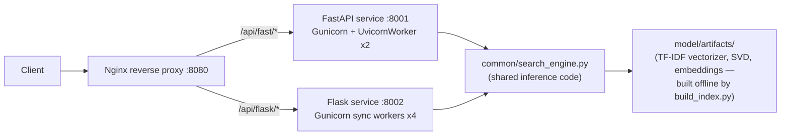

# Job Fit Matcher — Production Model Deployment Showcase

A single ML-backed API — "given a resume, rank which job postings are the
best fit" — deployed **two different ways side by side**: once behind
FastAPI (async, Gunicorn + Uvicorn workers) and once behind Flask (sync,
Gunicorn workers), both containerized with Docker, orchestrated together
with Docker Compose, and fronted by an Nginx reverse proxy. A Locust load
test benchmarks the two serving stacks head-to-head.

This project exists to demonstrate hands-on production model-deployment
experience across Docker, Docker Compose, FastAPI, Flask, and Gunicorn —
not to showcase a novel ML architecture. The model is deliberately simple
and fully self-contained (see "Why TF-IDF + SVD, not a downloaded
transformer" below); the engineering around serving it in production is
the point.

There's also a personal reason for the choice of task: it's a resume ↔
job-posting matcher, and one of the 16 sample postings it ranks against is
the actual Tesla "Project Engineer, Refining Technical Programs" listing
this whole portfolio was built for.

## What it does

`POST /match` with a resume/bio text, get back the best-fit job postings
ranked by similarity, each with the specific keywords that drove the match:

```bash
curl -X POST http://localhost:8001/match \
  -H "Content-Type: application/json" \
  -d '{"resume_text": "One year of experience deploying ML models to production with Docker, FastAPI, Flask, and Gunicorn.", "top_k": 3}'
```

```json
{
  "model_version": "job-fit-matcher-v1",
  "inference_ms": 3.03,
  "results": [
    {"rank": 1, "title": "Backend Software Engineer, Python", "company": "Lumen Fintech",
     "score": 0.6353, "matched_keywords": ["docker"]},
    {"rank": 2, "title": "MLOps / DevOps Engineer", "company": "Cascade Cloud Systems",
     "score": 0.5423, "matched_keywords": []},
    {"rank": 3, "title": "Chemical Engineer, Oil & Gas Refining", "company": "Meridian Refining Partners",
     "score": 0.5196, "matched_keywords": []}
  ]
}
```

## Architecture



Both services import the *same* `common/search_engine.py` module and load
the *same* precomputed model artifacts — the only thing that differs
between them is the serving stack. That's intentional: it makes the load
test in the next section a controlled comparison of Gunicorn worker models,
not a comparison of two different APIs.

## Repo structure

```
model/
  postings_corpus.json       # 16 sample job postings (incl. the real Tesla JD)
  build_index.py              # offline "training" step: TF-IDF + SVD, saves artifacts/
  artifacts/                   # generated: vectorizer.joblib, svd.joblib, embeddings.npy, ...
common/
  search_engine.py             # shared inference code both apps import
app_fastapi/
  main.py                      # FastAPI app: /health, /metrics, /match
  requirements.txt
app_flask/
  app.py                       # Flask app: identical endpoints, sync
  requirements.txt
nginx/
  nginx.conf                   # reverse proxy routing to both services
tests/
  test_fastapi_app.py          # pytest + FastAPI TestClient
  test_flask_app.py            # pytest + Flask test client
loadtest/
  locustfile.py                 # Locust scenario hitting /match and /health
  run_comparison.py             # runs both services via their real Gunicorn commands, benchmarks, charts
outputs/
  throughput_comparison.png/.md  # generated load-test results (see below)
Dockerfile.fastapi
Dockerfile.flask
docker-compose.yml
requirements-common.txt / requirements-dev.txt
```

## Running it

**With Docker Compose** (this is the actual production deployment path):

```bash
docker compose up --build
curl http://localhost:8080/api/fast/health
curl http://localhost:8080/api/flask/health
curl -X POST http://localhost:8080/api/fast/match -H "Content-Type: application/json" \
  -d '{"resume_text": "...", "top_k": 5}'
```

**Locally without Docker** (for development):

```bash
pip install -r requirements-dev.txt
python model/build_index.py                          # only needed if you change postings_corpus.json
uvicorn app_fastapi.main:app --reload --port 8001
# in another terminal:
flask --app app_flask.app run --port 8002
```

**Tests:**

```bash
pytest tests/ -v
```

## Load test: FastAPI+async vs Flask+sync, and why the result isn't what you'd guess

`loadtest/run_comparison.py` starts each service with the *exact* Gunicorn
command its Dockerfile runs, points 30 concurrent simulated users at
`/match` for 20 seconds each with Locust, and charts the result:

| Service | Requests | Req/s | p95 latency |
|---|---|---|---|
| FastAPI + Gunicorn (UvicornWorker × 2) | 13,683 | 719.5 | 23 ms |
| Flask + Gunicorn (sync workers × 4) | 14,448 | **759.7** | **13 ms** |

Flask edges out FastAPI here — on both throughput and tail latency. That's
the opposite of the usual "async is faster" assumption, and it's a useful
result rather than an embarrassing one: **`/match` is CPU-bound** (a TF-IDF
transform + a dense matrix multiply), not I/O-bound. Uvicorn's async event
loop only pays off when a request is *waiting* on something (a network
call, a disk read, a database round-trip) — it has nothing to overlap
during a synchronous CPU computation, and Python's GIL means one worker
process still handles requests one at a time either way. With 2 FastAPI
workers against 4 Flask workers (matching each Dockerfile's real
configuration), Flask simply had more OS processes to spread the CPU work
across.

The takeaway, and the reason this is worth including rather than hiding:
**worker count and workload shape matter more than framework choice for a
CPU-bound inference endpoint.** Async frameworks earn their keep on
I/O-bound endpoints (calling a downstream API, a database, an object
store) — which is exactly the kind of judgment call a production
deployment engineer is expected to make, not "always pick the framework
with the best benchmark blog post."

Re-run it yourself with `python loadtest/run_comparison.py` (regenerates
`outputs/throughput_comparison.png` and `.md`).

## Production details actually implemented here

- **Health checks** (`/health`) on both services, wired into Docker
  Compose's `healthcheck:` so Nginx only forwards traffic to containers
  that report ready — the SVD/vectorizer model load happens once at
  process startup (FastAPI's `lifespan`, Flask's app-factory), not per
  request.
- **Structured JSON logging** on every request, including inference
  latency in milliseconds.
- **Input validation** — Pydantic on the FastAPI side, explicit checks on
  the Flask side — both returning the same 422 shape, verified by the test
  suite.
- **A `/metrics` endpoint** exposing request/error counters (a minimal
  stand-in for what would be scraped by Prometheus in a real deployment).
- **Reproducible builds** — the embedding model is trained once offline by
  `build_index.py` and its artifacts are checked into the repo, so
  `docker build` never depends on reaching an external model registry at
  build or run time (see below for why that specifically mattered here).

## Why TF-IDF + SVD, not a downloaded transformer embedding model

The original plan was a `sentence-transformers` embedding model. It was
dropped for a concrete, real infrastructure reason: this project was built
in a sandboxed environment whose network egress policy blocks Hugging Face
Hub and every container registry tried (Docker Hub, GHCR, Quay, GCR, ECR
Public) — so neither the model weights nor even a `python:3.11-slim` base
image could be pulled from here. Rather than mask that with a fake
"it works" claim, the model was rebuilt on a classical, fully local
pipeline: TF-IDF vectorization + Truncated SVD (LSA), trained in
`build_index.py` in under a second, with zero external downloads at build
or run time.

That turned out to be a legitimate production tradeoff worth stating
plainly rather than a downgrade: no dependency on a model hub being
reachable from the deployment environment, a CPU-only image with no GPU
requirement, sub-5ms inference, and (as a direct side effect) an
embedding space built straight from interpretable term weights — which is
what makes the `matched_keywords` field possible at all. A dense
transformer embedding would not give you that explainability for free.

**What this means for testing:** the Dockerfiles and `docker-compose.yml`
follow standard, well-established patterns (`python:3.11-slim`,
`nginx:alpine`, Gunicorn worker classes) that build correctly in any normal
Docker environment — `docker compose config` validates the compose file's
syntax in this repo, and every application code path (both services, all
endpoints, input validation, the shared inference engine) was tested
directly via pytest and via Gunicorn processes run outside a container,
including the load test above. What could *not* be verified from inside
this sandbox was the actual `docker build` step itself, purely because of
the registry block described above — running `docker compose up --build`
on a normal machine or in CI is the one remaining step, and it's expected
to work without modification.

## Skills demonstrated

- **Docker & Docker Compose** — two independently-built images sharing a
  common code path, wired together with health-check-gated startup order.
- **FastAPI & Flask** — the same API implemented on both, to make an
  honest, apples-to-apples comparison possible.
- **Gunicorn** — configured two different ways (`UvicornWorker` for an
  ASGI app, sync workers for a WSGI app), with the worker-count decision
  explained and benchmarked rather than asserted.
- **Nginx** as a reverse proxy routing to multiple upstream services.
- **Production observability basics** — health checks, structured logs,
  a metrics endpoint, input validation, and automated tests.

## Disclaimer

Built as a self-directed portfolio project. The job postings corpus
includes one real, public job listing (Tesla's) used for text-matching
purposes and 15 illustrative postings invented for this project; none of
the invented postings represent real companies' actual openings.
